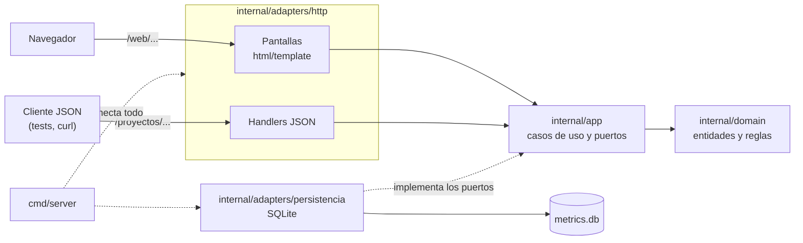
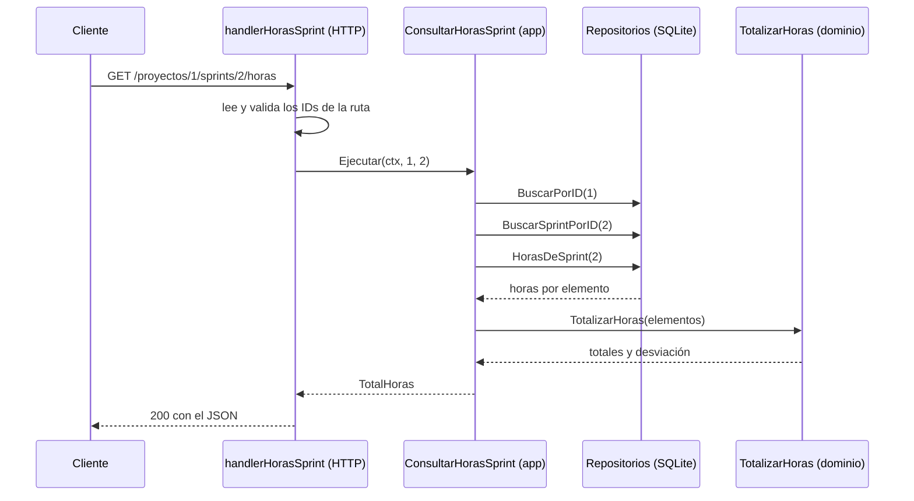

# Arquitectura

Software Metrics & Estimation es un solo programa en Go: un servidor web que guarda los datos en SQLite y ofrece dos interfaces sobre la misma lógica. Una son las **pantallas**, páginas HTML generadas en el servidor para usar desde el navegador. La otra es una **API JSON**, que usan los tests y cualquier otro cliente.

El código sigue una **arquitectura hexagonal** (puertos y adaptadores): las reglas de negocio no saben nada de HTTP ni de SQLite, y se prueban sin levantar el servidor ni abrir una base.

## Vista general



## Capas

| Carpeta | Qué tiene | De qué depende |
|---|---|---|
| `internal/domain` | Entidades (proyecto, elemento del backlog, sprint, ronda de Planning Poker, registro de esfuerzo, defecto), reglas de negocio, cálculos de métricas y errores. | Solo de la biblioteca estándar de Go. |
| `internal/app` | Un caso de uso por acción (`CrearProyecto`, `CerrarSprint`, `ConsultarHorasSprint`…) y los **puertos**: las interfaces que necesita para leer y guardar. | Del dominio. |
| `internal/adapters/http` | Las rutas JSON y las pantallas. Traducen el pedido a una llamada al caso de uso y el resultado o el error a una respuesta. | De los casos de uso y del dominio. |
| `internal/adapters/persistencia` | Los repositorios sobre SQLite, que implementan los puertos. | Del dominio y del driver de SQLite. |
| `cmd/server` | El `main`: abre la base, arma los repositorios y los casos de uso, y levanta el servidor. | De todo lo anterior. |

Las dependencias apuntan siempre hacia el dominio. Se puede comprobar con:

```bash
go list -f '{{.ImportPath}}: {{join .Imports " "}}' ./internal/domain ./internal/app
```

El dominio solo importa paquetes estándar (`errors`, `time`, `slices`…), y `internal/app`, el dominio y paquetes estándar.

### Dominio

Cada regla de negocio de las specs (`RN-XX.N`) vive acá, con su test. Por ejemplo, `TotalizarHoras` (HU-23) suma las horas y calcula la desviación, y `Ronda.RegistrarEstimacion` (HU-17) decide si se puede registrar una estimación.

- **Errores:** cada error de negocio es una variable (`ErrProyectoNoEncontrado`, `ErrSprintCerrado`…) con el mensaje que ve el usuario. Los adaptadores los reconocen con `errors.Is`.
- **Sin entrada ni salida:** el dominio no lee la base, la hora ni la red. Si una regla necesita "hoy", el caso de uso le pasa la fecha.

### Casos de uso

Cada caso de uso es un `struct` con un constructor `NuevoX(...)` y un método `Ejecutar(ctx, ...)`. El flujo habitual es buscar lo que hace falta, aplicar el dominio y guardar el resultado.

Los **puertos** son interfaces chicas, definidas en `internal/app` junto a quien las usa. Por ejemplo, `ConsultarHorasSprint` recibe tres:

```go
type LectorSprintPorID interface {
	BuscarSprintPorID(ctx context.Context, id int64) (domain.Sprint, error)
}
```

Como los puertos son chicos, cada caso de uso pide solo lo que usa, y en los tests se reemplazan con implementaciones falsas de pocas líneas.

Los casos de uso que necesitan la fecha reciben un reloj (`func() time.Time`). En producción es `time.Now`, y los tests le pasan una fecha fija.

### Adaptador HTTP

Usa `net/http` de la biblioteca estándar, con rutas por método (ADR-0001).

- **API JSON:** cada historia registra sus rutas con su función `RegistrarX(mux, casoDeUso)`, y `NuevoRouter` (`router.go`) las junta. Los errores de dominio se traducen a códigos HTTP: lo inexistente da `404`, una regla que no se cumple da `400` y cualquier otra falla da `500`, con un mensaje genérico y el detalle solo en el log.
- **Pantallas:** páginas HTML con `html/template` (ADR-0003), bajo `/web/...`. Las plantillas y `estilos.css` se embeben en el ejecutable con `go:embed`, y llaman a **los mismos casos de uso** que la API, así que no hay validaciones repetidas.
- **Formularios:** cada `POST` pasa por `formulario`, que rechaza los envíos desde otro sitio (protección CSRF sin token, porque no hay sesiones) y limita el tamaño del cuerpo. Al guardar, redirige con `303` (POST-redirect-GET). Si hay un error, se muestra en la misma pantalla con el mensaje del dominio.
- **Encabezados de seguridad:** las pantallas responden con `Content-Security-Policy: default-src 'self'`, que no permite scripts ni estilos de otros sitios ni en línea, y con `X-Content-Type-Options` y `Referrer-Policy`.

### Adaptador de persistencia

Usa SQLite con `modernc.org/sqlite`, un driver escrito en Go que no necesita CGO (ADR-0002).

- **Apertura:** `AbrirDB` activa las claves foráneas y una espera de 5 segundos si la base está ocupada, y aplica las migraciones.
- **Migraciones:** el esquema se crea con `CREATE TABLE IF NOT EXISTS`. Las columnas que sumó cada historia se agregan a las bases existentes con `agregarColumnas`, así una base vieja se actualiza sola al arrancar.
- **Pedidos simultáneos:** cuando una regla depende del estado guardado (por ejemplo, que el sprint siga abierto), la condición va dentro del mismo `UPDATE` o de una transacción. Así dos pedidos simultáneos no pueden dejar datos inconsistentes.
- **Horas:** se guardan como medias horas enteras, para que las sumas sean exactas.

### Arranque

`cmd/server/main.go` lee dos variables de entorno: `DB_PATH` (por defecto `metrics.db`) y `PORT` (por defecto `8080`). Configura tiempos máximos de lectura y escritura, y al recibir `Ctrl+C` o `SIGTERM` (la señal con la que Render detiene el servidor) termina los pedidos en curso y cierra la base.

## Cómo viaja un pedido

Ejemplo: `GET /proyectos/1/sprints/2/horas`, las horas de un sprint (HU-23).



1. **HTTP:** el handler lee los IDs de la ruta. Si no son enteros positivos, responde `400` sin llamar al caso de uso.
2. **Caso de uso:** busca el proyecto y el sprint por sus puertos, y comprueba que el sprint sea de ese proyecto. Si algo no existe, devuelve el error del dominio.
3. **Persistencia:** `HorasDeSprint` devuelve una fila por elemento del sprint, con sus horas estimadas y reales.
4. **Dominio:** `TotalizarHoras` suma y calcula la desviación.
5. **HTTP:** el handler responde `200` con el JSON. Si hubo un error, `responderErrorHoras` lo traduce: `404` para un proyecto o sprint inexistente, `500` para lo demás.

La pantalla del sprint (`GET /web/proyectos/1/sprints/2`) llama al mismo caso de uso, y el resultado se muestra en el bloque "Horas y desviación".

## Tests por capa

| Capa | Cómo se prueba |
|---|---|
| Dominio | Tests unitarios, con TDD (commits `[RED]` y `[GREEN]`). |
| Casos de uso | Tests con puertos falsos, sin base. |
| HTTP | `net/http/httptest`: se registra solo la ruta de la historia con `RegistrarX`. `router_test.go` verifica que `NuevoRouter` tenga todas las rutas. |
| Persistencia | Tests contra una base SQLite nueva en una carpeta temporal. |
| BDD | Escenarios Given-When-Then en `features/`, corridos con godog desde `test/bdd/`. Cada historia tiene sus *steps* y, en general, un "sistema" que conecta los casos de uso con una base SQLite nueva por escenario. |

El CI corre todo con `-race` y exige una cobertura mínima del 80 % (ADR-0004).

## Decisiones técnicas

Las decisiones de arquitectura están en [`docs/adr/`](adr/), una por archivo, con el contexto, las alternativas y las consecuencias.

| Tema | Decisión | Registro |
|---|---|---|
| Lenguaje | Go (la versión está en `go.mod`). El núcleo y las reglas de negocio van en Go, como pide la cátedra. | Enunciado del TP |
| Rutas HTTP | `net/http` de la biblioteca estándar, sin framework. | [ADR-0001](adr/0001-framework-web.md) |
| Persistencia | SQLite con `modernc.org/sqlite`, sin CGO, en un solo archivo. | [ADR-0002](adr/0002-persistencia.md) |
| Interfaz | Páginas generadas en el servidor con `html/template` y un CSS propio, sin JavaScript hasta ahora. | [ADR-0003](adr/0003-interfaz-web.md) |
| CI/CD | GitHub Actions con `-race` y cobertura mínima del 80 %, `main` protegida y despliegue en Render. El despliegue todavía no está activo: falta configurar Render. | [ADR-0004](adr/0004-ci-cd.md) |
| Organización del código | Arquitectura hexagonal: dominio, casos de uso y adaptadores (este documento). | [`CLAUDE.md`](../CLAUDE.md) |
| BDD | Escenarios en Gherkin automatizados con godog. | [`CLAUDE.md`](../CLAUDE.md) |

**Pendientes del Sprint 4:**
- **ADR-0005, gráficos del Dashboard** (HU-25, tarea 25.1): tiene que respetar la política de seguridad de las pantallas, que bloquea scripts de otros sitios y scripts en línea.
- **ADR-0006, exportar a PDF** (HU-27, tarea 27.1): la librería tiene que funcionar en Render sin dependencias del sistema.

**Decisiones de diseño que salen de las specs y valen para todo el sistema:**
- **Sin usuarios ni sesiones:** cualquiera que llegue a una ruta puede usarla, y no se controla qué rol hace cada acción. Por eso los formularios se protegen comprobando el origen y no con un token.
- **Horas en medias horas enteras** (HU-18 y HU-19), para que las sumas sean exactas.
- **Los errores de dominio llevan el mensaje que ve el usuario:** las pantallas y la API lo muestran tal cual, salvo las fallas internas, que solo van al log.

## Dónde va cada cosa al sumar una historia

1. Spec en `docs/specs/HU-XX-*.md` y escenarios en `features/HU-XX-*.feature`.
2. Reglas y cálculos en `internal/domain`, con sus tests primero.
3. Caso de uso y puertos en `internal/app`.
4. Repositorio en `internal/adapters/persistencia`; si hace falta una columna nueva, se suma con `agregarColumnas`.
5. Rutas JSON en un `*_handler.go` con su `RegistrarX`, sumado a `NuevoRouter`, a `CasosDeUso` y a `router_test.go`.
6. Pantalla en `pantallas_*.go` y `web/plantillas/`.
7. Conexión en `cmd/server/main.go`.

Las convenciones de commits, ramas y nombres están en [`CLAUDE.md`](../CLAUDE.md), y la relación entre historias, specs, tests y código, en [`trazabilidad.md`](trazabilidad.md).
