# Manual de usuario

Software Metrics & Estimation sirve para planificar, estimar y medir proyectos de software: un proyecto tiene un equipo, un Product Backlog y sprints, y sobre eso el sistema calcula la velocidad, las horas y su desviación, y los defectos.

Este manual recorre las pantallas en el orden en que las usa alguien que arranca un proyecto. Las capturas son del **proyecto de ejemplo**: este mismo TP, con sus historias, sus sprints y sus defectos.

## Cómo entrar

- **Versión publicada:** <https://ingsoft-tpintegrador.onrender.com>. Arranca con el proyecto de ejemplo cargado. Si nadie la usó en un rato, la primera visita tarda cerca de un minuto. Los datos se borran en cada despliegue.
- **En tu máquina:** seguí los pasos del [README](../README.md#puesta-en-marcha) y abrí <http://localhost:8080>. Para arrancar con el proyecto de ejemplo, definí la variable `CARGAR_EJEMPLO=true` con la base vacía.

No hace falta usuario ni contraseña: el sistema no tiene sesiones.

## 1. Proyectos

La pantalla de inicio lista los proyectos, con su fecha de inicio, su fecha de fin y su estado.

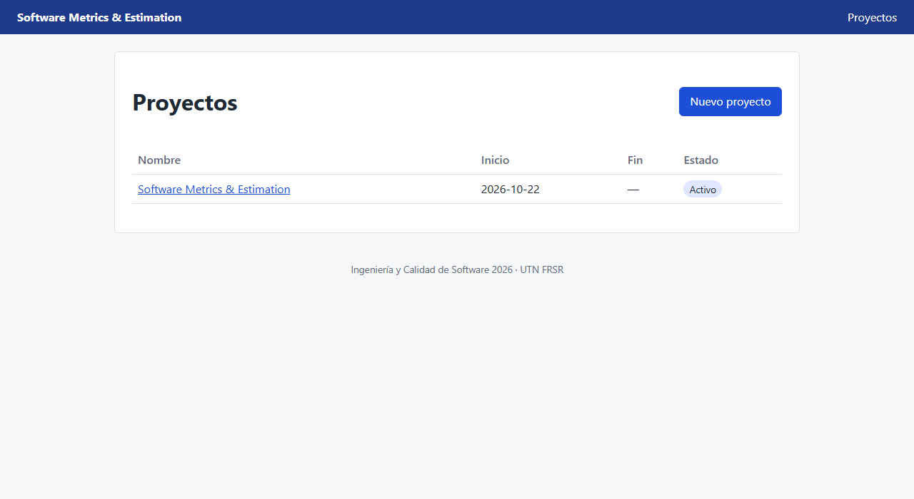

**Crear un proyecto:** tocá **Nuevo proyecto** y completá:
- **Nombre:** obligatorio, hasta 100 caracteres, y distinto de los demás proyectos (sin importar mayúsculas).
- **Fecha de inicio:** obligatoria.
- **Fecha de fin:** opcional; si la ponés, no puede ser anterior a la de inicio.

El proyecto queda en estado **Activo**.

**El detalle del proyecto** tiene los botones para todo lo demás: **Dashboard**, **Backlog**, **Sprints**, **Sprints anteriores**, **Defectos**, **Ver reporte** y **Editar**. También muestra las horas del proyecto y su equipo.

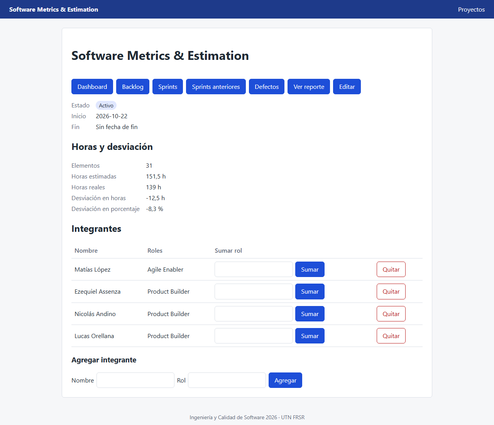

**Editar:** cambia el nombre, las fechas o el estado (Activo, En pausa, Finalizado, Postergado o Cancelado). Solo en un proyecto **Activo** se pueden crear sprints.

**Integrantes:** en la sección **Integrantes**, cargá el nombre y el rol y tocá **Agregar**. Para sumarle otro rol a alguien, escribilo en su fila y tocá **Sumar**. **Quitar** lo saca del proyecto; sus registros de esfuerzo se conservan.

## 2. Product Backlog

Desde el proyecto, **Backlog** lista los elementos, con su prioridad, estado y story points. Arriba podés filtrarlos por estado y ordenarlos por prioridad.

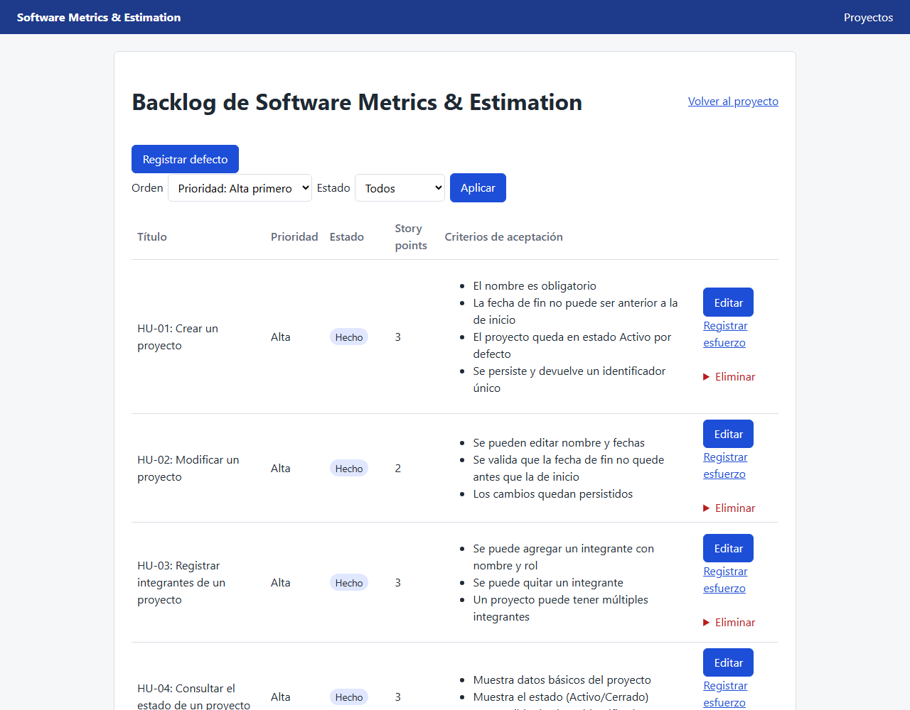

**Agregar un elemento:** en **Nuevo elemento**, completá:
- **Título:** obligatorio, hasta 100 caracteres, y sin repetirse en el proyecto.
- **Descripción:** obligatoria.
- **Prioridad:** Alta, Media o Baja.
- **Story points:** opcionales. Si se cargan, tienen que ser de la escala de Fibonacci: 1, 2, 3, 5, 8, 13 o 21.
- **Criterios de aceptación:** al menos uno, uno por línea.

El elemento queda **Pendiente**.

**Editar o eliminar:** **Editar** abre el elemento. Ahí se cambian todos sus datos, incluidas las **horas estimadas**, en pasos de media hora y hasta 1000 h. Para eliminarlo, el sistema pide confirmación. No se puede eliminar un elemento que tiene esfuerzo o defectos registrados.

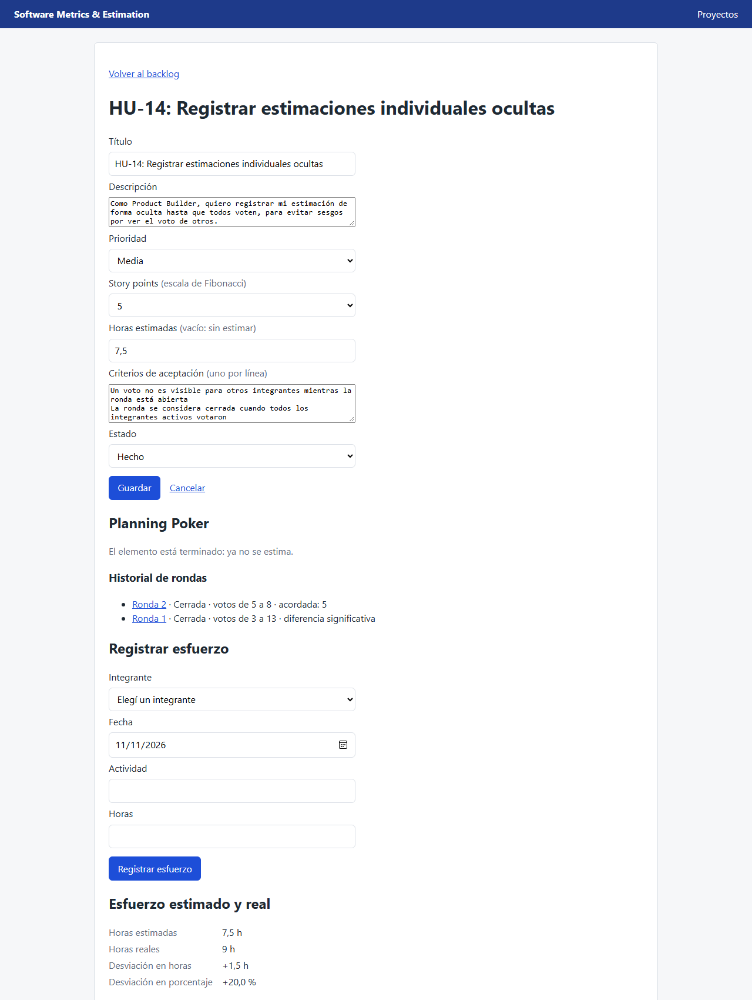

## 3. Estimar con Planning Poker

El equipo estima un elemento votando a ciegas: nadie ve los votos de los demás hasta que votaron todos.

1. En la pantalla del elemento, en **Planning Poker**, tocá **Iniciar ronda**. Votan todos los integrantes que tiene el proyecto en ese momento. Un elemento **Hecho** ya no se estima.
2. Cada integrante elige su nombre y un valor de la escala y toca **Votar**. Mientras la ronda está abierta, solo se ve quién votó y quién falta, y cada uno puede volver a votar.

   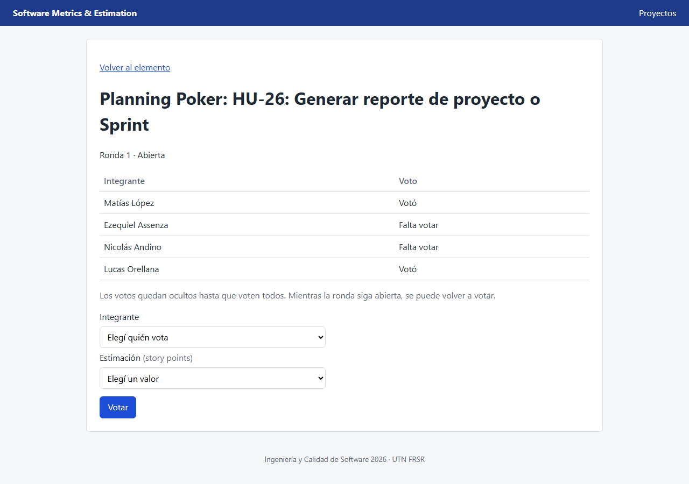

3. Cuando votaron todos, la ronda se cierra sola y muestra los votos, el mínimo y el máximo, y si hay una **diferencia significativa**.
4. Si hay diferencias, el equipo las discute e inicia **otra ronda** sobre el mismo elemento. Las anteriores quedan en el **Historial de rondas** del elemento.
5. En la última ronda, ya cerrada, registrá la **estimación acordada**. Puede ser cualquier valor de la escala, aunque nadie lo haya votado, y pasa a ser los story points del elemento.

   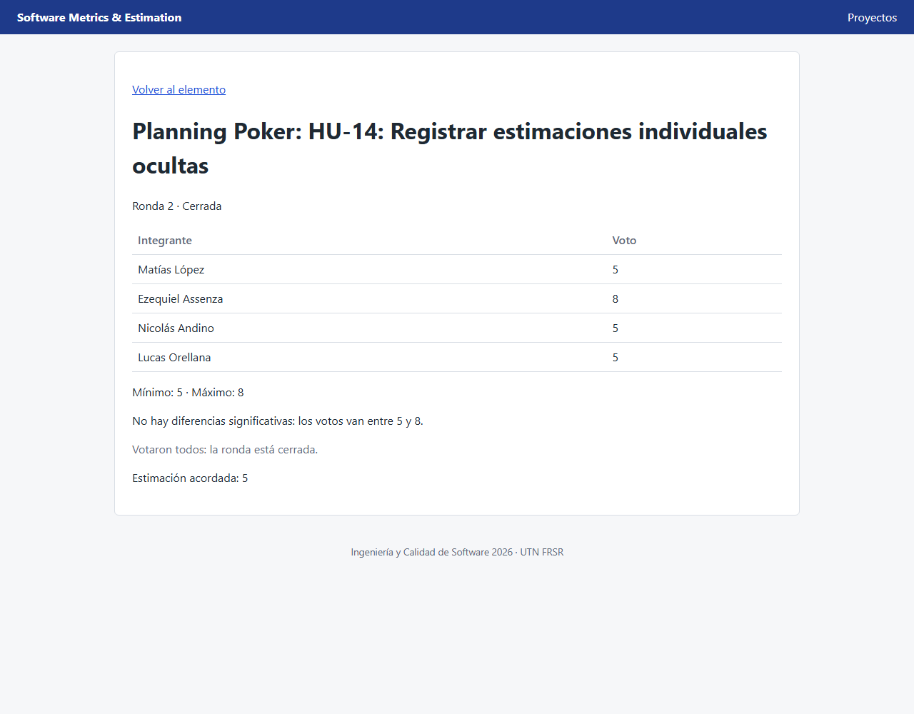

## 4. Sprints

Desde el proyecto, **Sprints** lista los sprints del proyecto.

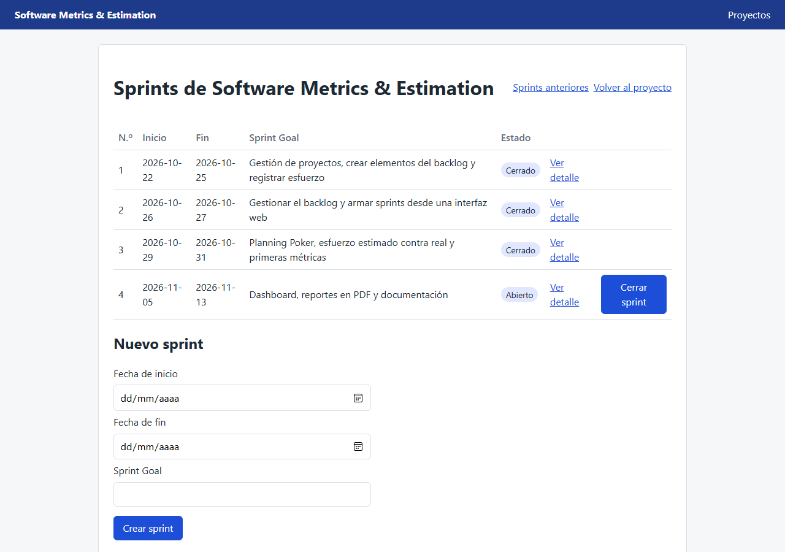

**Crear un sprint:** en **Nuevo sprint**, cargá la fecha de inicio, la de fin y el **Sprint Goal**, y tocá **Crear sprint**. El sprint tiene que estar dentro de las fechas del proyecto y no puede superponerse con otro sprint. Queda **Abierto**, con el número siguiente.

**El detalle de un sprint** (**Ver detalle**):
- **Sumar un elemento:** elegí un elemento del backlog sin sprint y asignalo.
- **Marcar como hecha:** pasa el elemento a **Hecho**.
- **Quitar:** devuelve el elemento al backlog.
- **Horas y desviación:** las horas estimadas y reales de los elementos del sprint.
- **Ver reporte:** el reporte del sprint (sección 8).

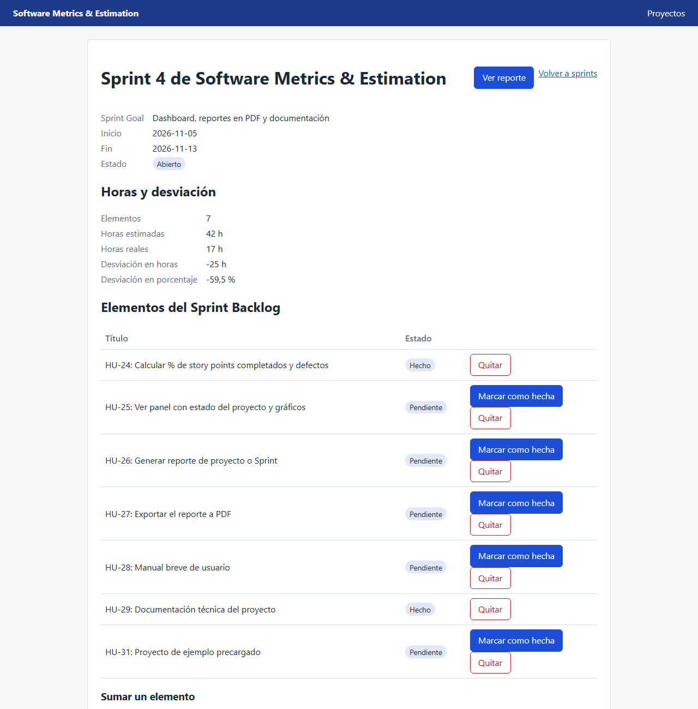

**Cerrar un sprint:** en la lista de sprints, **Cerrar sprint**. Al cerrar:
- el sprint guarda sus puntos planificados y completados;
- las historias que no se terminaron vuelven al Product Backlog, para planificarlas en otro sprint;
- un sprint cerrado no se reabre, ni se le asignan o quitan elementos.

**Sprints anteriores** muestra los sprints cerrados, del más reciente al más antiguo, con sus puntos, el porcentaje completado, los defectos detectados y resueltos, y la **velocidad del equipo**, que es el promedio de los puntos completados en los últimos tres sprints cerrados.

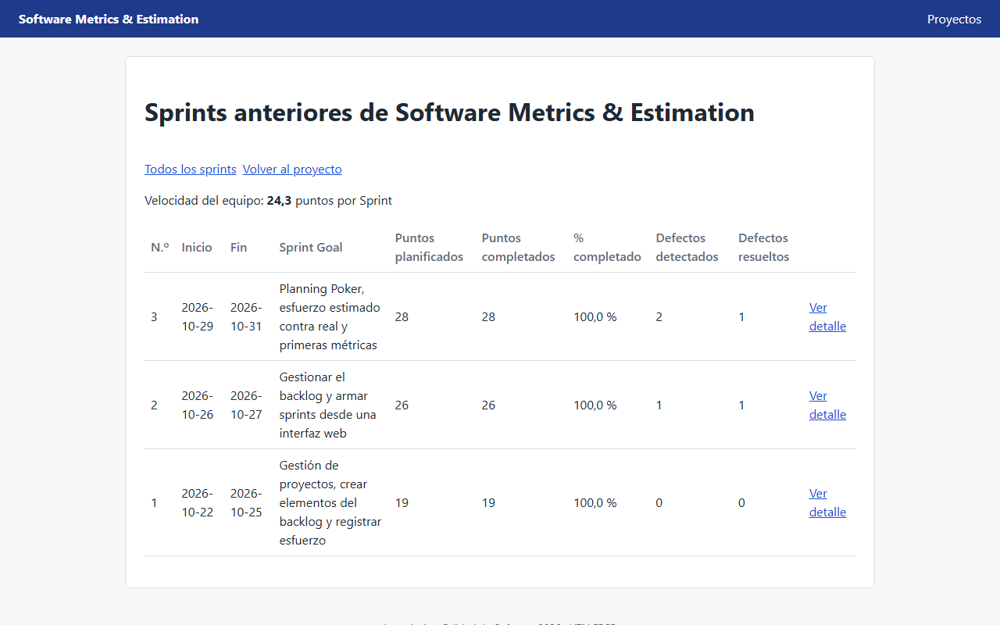

## 5. Esfuerzo

En la pantalla de un elemento, en **Registrar esfuerzo**, cargá quién trabajó, la fecha, la actividad y las horas.
- La fecha no puede ser futura.
- Las horas van en pasos de media hora, hasta 24 h por registro.
- Solo puede registrar esfuerzo un integrante del proyecto.

Debajo, **Esfuerzo estimado y real** compara las horas estimadas del elemento con las registradas: la desviación en horas y en porcentaje. Si el elemento no tiene horas estimadas, dice "Sin estimar".

El proyecto y cada sprint muestran el mismo cálculo sobre todos sus elementos, en **Horas y desviación**. Las horas de los elementos sin estimar se suman a las reales, pero no a la desviación.

## 6. Defectos

Desde el proyecto, **Defectos** lista los defectos, con su severidad, su estado y los sprints en que se detectaron y se resolvieron.

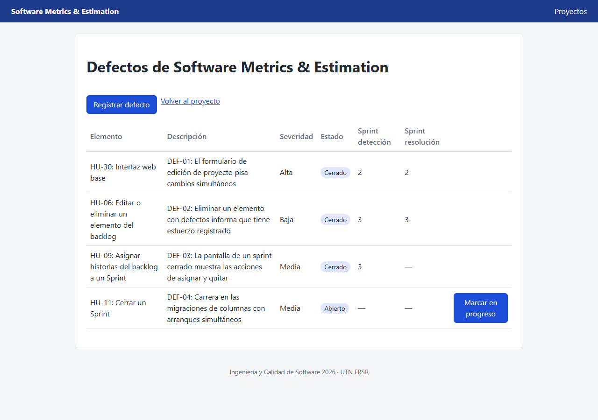

**Registrar un defecto:** tocá **Registrar defecto**, elegí el elemento del backlog, y cargá la descripción y la severidad (Crítica, Alta, Media o Baja). El defecto queda **Abierto**, y se le asigna solo el sprint abierto en curso como sprint de detección.

**Cambiar su estado:** cada defecto avanza un paso por vez, con el botón de su fila: **Abierto → En progreso → Resuelto → Cerrado**. No se puede saltear un paso ni volver atrás. Al resolverlo, se le asigna el sprint en curso como sprint de resolución.

## 7. Dashboard

Desde el proyecto, **Dashboard** muestra de un vistazo cómo viene el proyecto:
- **Backlog:** cuántos elementos hay en cada estado.
- **Sprint en curso:** el sprint abierto que incluye la fecha de hoy, con sus puntos completados hasta ahora.
- **Sprints cerrados:** gráficos de los puntos planificados y completados (con la velocidad como línea), del porcentaje completado y de los defectos de cada sprint.
- **Horas del proyecto:** las estimadas contra las reales, con la desviación.

Cada gráfico tiene debajo una tabla con sus datos.

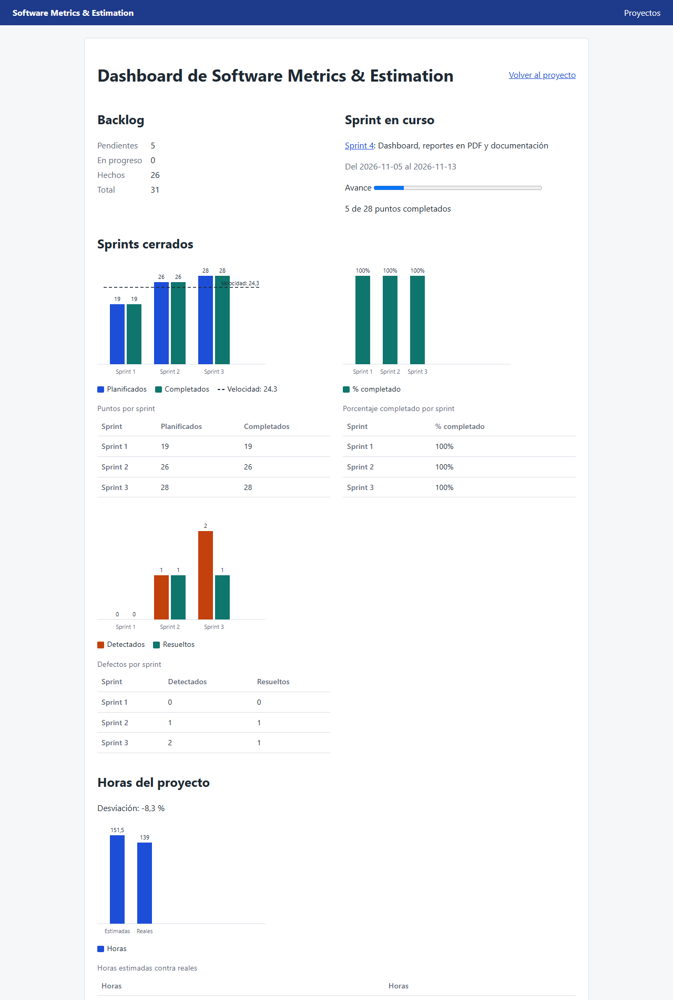

## 8. Reporte y PDF

**Ver reporte**, desde el proyecto o desde un sprint, junta en una página:
- **Resumen:** los datos del proyecto o del sprint.
- **Historias y estimaciones:** cuántas se completaron y sus story points.
- **Esfuerzo:** las horas y su desviación.
- **Métricas:** la velocidad y el porcentaje completado.
- **Defectos:** con sus sprints de detección y de resolución.

**Descargar PDF** baja el mismo reporte como documento, para entregarlo o compartirlo. Los emojis y otros símbolos que la fuente del PDF no puede mostrar se reemplazan por «?», y el PDF avisa cuántos.

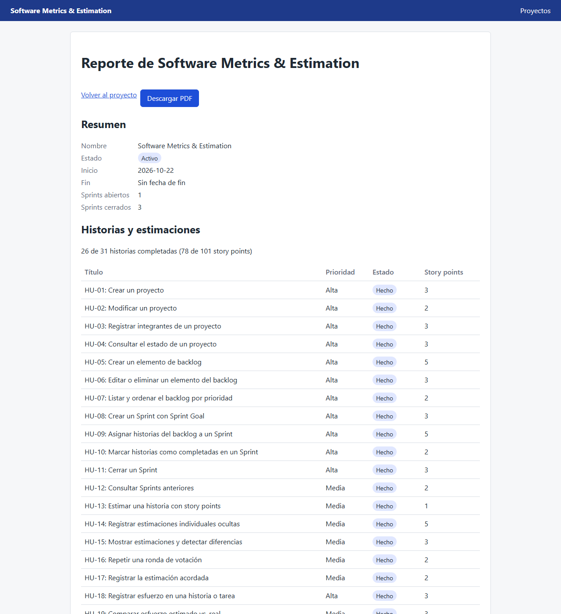
